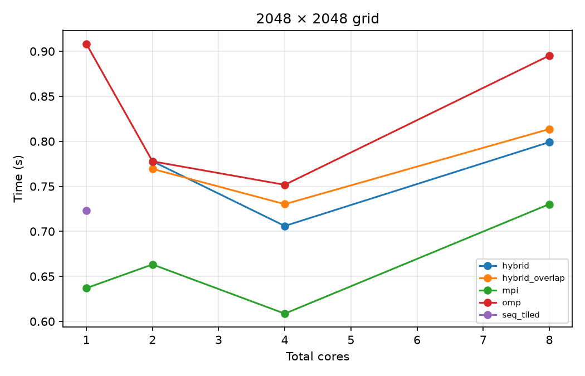
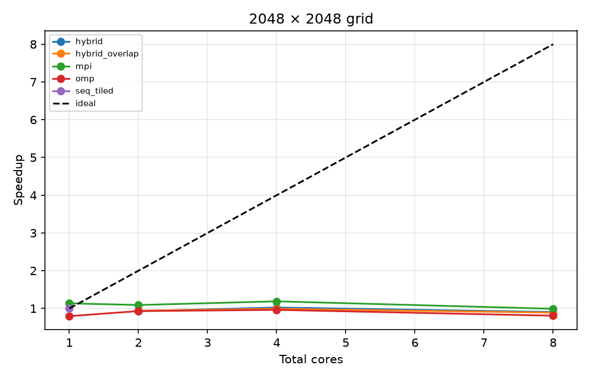
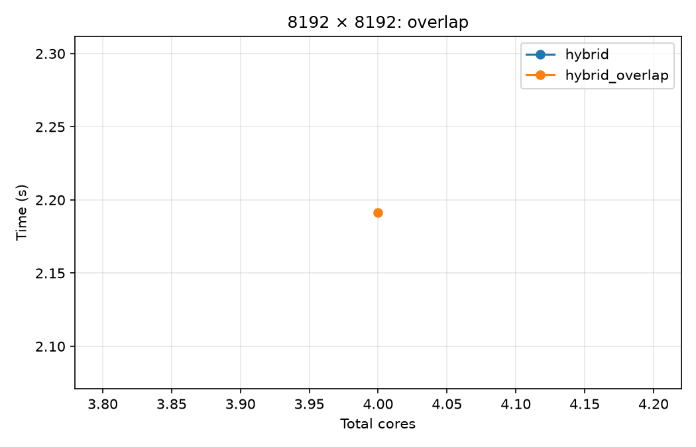
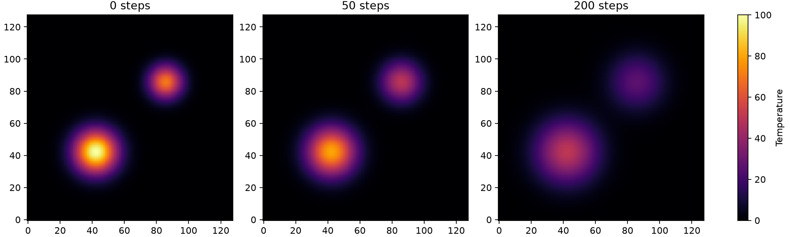

# Parallel 2D Heat Diffusion with Hybrid MPI and OpenMP

A C++17 implementation of explicit two-dimensional heat diffusion, comparing a naive sequential loop, a tiled sequential loop, OpenMP, MPI, and hybrid MPI/OpenMP with blocking and overlapped halo exchanges. Built for the Parallel and Distributed Computing course by Sajjad Ahmed (23K-0754), Wali Uddin (23K-0719), and Saad Zaidi (23K-0874).

## Numerical method

Each interior cell is updated with the five-point stencil

```text
u_new[y,x] = u[y,x] + alpha*dt/dx² *
             (u[y-1,x] + u[y+1,x] + u[y,x-1] + u[y,x+1] - 4*u[y,x])
```

Boundary cells stay fixed at `--boundary` (default zero). The default time step is `0.9 dx²/(4 alpha)`; larger values than `dx²/(4 alpha)` are rejected. Double-precision grids use two contiguous row-major arrays and pointer swaps. `hotspots` gives two fixed Gaussian hot spots; `random` uses a coordinate hash and `--seed` so each strip can regenerate the same values independently. `sine` supplies a discrete eigenmode with a known exact decay for testing.

## Parallel layout

```text
rank 0: [ fixed top | owned rows ... | halo from rank 1 ]
rank 1: [ halo from 0 | owned rows ... | halo from 2 ]
rank 2: [ halo from 1 | owned rows ... | fixed bottom ]
```

Ranks get contiguous horizontal strips; extra rows go to lower ranks. Rank 0 scatters a full input grid using `MPI_Scatterv`, then gathers the final field with `MPI_Gatherv`. `--local-init` generates strips from global coordinates to reduce initial root memory. Each process has top and bottom halo rows. `mpi` and `hybrid` use `MPI_Sendrecv` for halo exchange, followed by computation. `hybrid_overlap` posts four nonblocking requests, computes rows that do not depend on incoming halos, waits, then computes strip edge rows. MPI is initialized with `MPI_THREAD_FUNNELED`, and all MPI calls stay on the main thread. OpenMP uses static row or tile scheduling, SIMD inner loops, and first-touch array initialization. Set `OMP_PROC_BIND=close` and `OMP_PLACES=cores` for pinning; MPI launchers commonly support `--bind-to core` (check your launcher).

## Build

On Linux, install a C++17 compiler, CMake, Make, OpenMPI or MPICH development packages, Python 3, and `python3 -m pip install -r scripts/requirements.txt`. Then:

```bash
cmake -S . -B build -DCMAKE_BUILD_TYPE=Release
cmake --build build -j
# or: make
```

The default binary is `build/heat`. Compilation uses `-O3 -march=native -Wall -Wextra` with GNU/Clang. For portable binaries, remove `-march=native` from CMake options.

The measured Windows build used MSYS2 UCRT64 GCC, CMake, and Microsoft MPI plus its SDK. Configure from PowerShell after adding `C:\msys64\ucrt64\bin` and `C:\Program Files\Microsoft MPI\Bin` to `PATH` and setting `MSMPI_INC` and `MSMPI_LIB64` to the SDK's `Include` and `Lib\x64` directories, respectively. Use `cmake -S . -B build -G Ninja -DCMAKE_BUILD_TYPE=Release`, then `cmake --build build`.

## Run

```bash
./build/heat --mode seq_naive --size 128 --steps 100
./build/heat --mode seq_tiled --size 2048 --steps 1000 --tile 64
./build/heat --mode omp --size 2048 --threads 8
mpirun -np 8 ./build/heat --mode mpi --threads 1
mpirun -np 4 ./build/heat --mode hybrid --threads 2
mpirun -np 2 ./build/heat --mode hybrid_overlap --threads 4
mpirun -np 4 ./build/heat --mode hybrid_overlap --threads 2 --init random --seed 17 --local-init --verify
./build/heat --size 128 --steps 50 --dump results/dumps/heat.csv
```

The JSON output reports rank-max initialization, communication (including final gather), computation, and wall time; GFLOPS counts five floating-point operations per interior update. It also reports sum, mean, extrema, center sample, and optional maximum relative verification error. `--output csv-line` prints a compact row without a header. Dumps are CSV, downsampled to at most roughly 256 points per axis. Use `--help` for all options. The solver rejects arrays with more than 2³¹−1 global elements due to the MPI `int` counts/displacements API; very large grids may also exceed available RAM.

## Tests and measurement

```bash
ctest --test-dir build --output-on-failure
python3 scripts/verify.py --binary build/heat
# or: make test
python3 scripts/benchmark.py --binary build/heat --quick --repeats 2
python3 scripts/benchmark.py --binary build/heat --repeats 5
python3 scripts/plot_results.py results/benchmarks.csv
python3 scripts/plot_heatmaps.py --binary build/heat
python3 scripts/generate_report.py
```

`verify.py` compares every version against an independent sequential reference to relative tolerance `1e-10`, including uneven strips and a 1024² case, and checks the exact discrete sine-mode decay and total heat decay. The benchmark runner detects logical CPU count, runs a warmup before each configuration, sweeps core splits and tile sizes, and writes only measured results to CSV. The full sweep includes 2048², 4096², and 8192², while `--quick` uses 128² and 256². The naive version runs only on the smallest grid. Use `--cores`, `--modes`, `--tiles`, `--sizes`, and `--steps` to limit a sweep. The plotting script reads one or more measured CSVs and creates time, speedup, efficiency, split, overlap, breakdown, and tile plots in `results/plots/`. `plot_heatmaps.py` runs a small grid at 0, 50, and 200 steps to make a field visualization.

The complete submission report is available as [`docs/PDC_Heat_Diffusion_Project_Report.pdf`](docs/PDC_Heat_Diffusion_Project_Report.pdf). It can be regenerated from the measured CSV files and plots with `python3 scripts/generate_report.py`.

## Measured results

The local machine was an AMD Ryzen 5 3600 (6 physical cores, 12 logical), 7.93 GiB RAM, Windows 11 Pro, GCC 16.2.0 (MSYS2 UCRT64), Microsoft MPI 10.1.12498.52, and CMake 4.4.4. These measurements were taken on Windows for development; the project targets Linux with OpenMPI or MPICH. Timing is the median of the measured repetitions and includes array initialization, scatter, all stencil steps, and final gather. The 128² and 256² quick sweeps have five repetitions; the 2048² sweep has two; the 4096² and 8192² sweeps have one. Each configuration also had one unrecorded warmup. The tuned baseline is the fastest measured single-thread tiled run for that size.

| Grid | Steps | Best sequential tile | Baseline time | Fastest run with ≥2 cores | Time | Speedup |
|---:|---:|---:|---:|---|---:|---:|
| 128² | 10 | 64 | 0.000454 s | MPI 2×1 | 0.000922 s | 0.49× |
| 256² | 10 | 64 | 0.001536 s | MPI 2×1 | 0.001873 s | 0.82× |
| 2048² | 100 | 256 | 0.723145 s | MPI 4×1 | 0.608636 s | 1.19× |
| 4096² | 20 | 256 | 0.905827 s | MPI 2×1 | 0.834966 s | 1.08× |
| 8192² | 5 | 256 | 2.133336 s | hybrid overlap 2×2 | 2.191422 s | 0.97× |

All 381 measured rows are in [`results/benchmarks.csv`](results/benchmarks.csv), with the source sweeps retained as separate CSVs. The sum was identical across implementations for each grid and step count (for example, about 20,789,890 at 2048²/100 steps), and sampled final-step stencil checks passed for runs made after that check was added. The full numerical regression suite passed with a maximum reported relative error of zero at the printed precision.






The plotted data shows that tiny grids lose time to rank and thread overhead. At 2048², four MPI ranks were fastest among the tested parallel splits. A 2×2 hybrid run took 0.707 s without overlap and 0.773 s with overlap, so overlap did not help at this size and step count. Each rank exchanges two rows per step; with fewer owned rows, that exchange and OpenMP scheduling take a larger share of useful work. Tiling at 256 was faster than 64 in the sequential sweeps, consistent with cache and memory bandwidth effects, though the short runs and Windows runtime noise limit broad conclusions. Uneven partitions are numerically tested at 131 rows with three ranks but were not benchmarked separately.

The 8192² single-rank run initially failed the conservative available-memory guard while RAM was occupied; it succeeded when memory became available. The 16384² case and the requested 1000-step large-grid sweeps were not measured on this 7.93 GiB machine. The 8192² data has only five steps and one repetition, so it primarily measures initialization and gather overhead; it is not evidence of steady-state scalability. No times or speedups are extrapolated for unrun configurations. To reproduce the plots: `python3 scripts/plot_results.py results/benchmarks.csv`.

## Files

- `src/main.cpp`: CLI, initialization, kernels, MPI decomposition and halo logic, verification, metrics.
- `scripts/verify.py`: numerical regression and analytic test.
- `scripts/benchmark.py`: warmup, repeated measurements and sweep.
- `scripts/plot_results.py`: graphs generated from CSV.
- `scripts/plot_heatmaps.py`: small-grid temperature visualizations.
- `results/`: measured CSV and plots.

MIT licensed; see [LICENSE](LICENSE).
